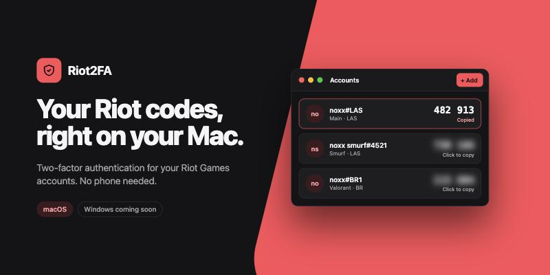
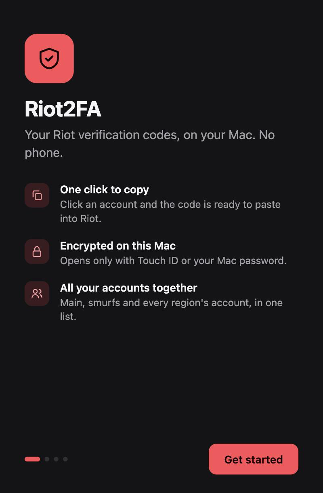
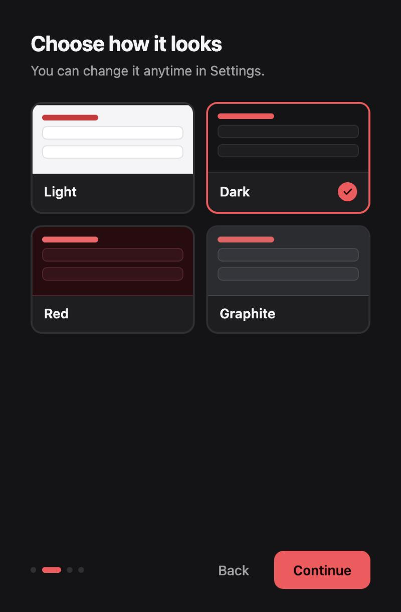
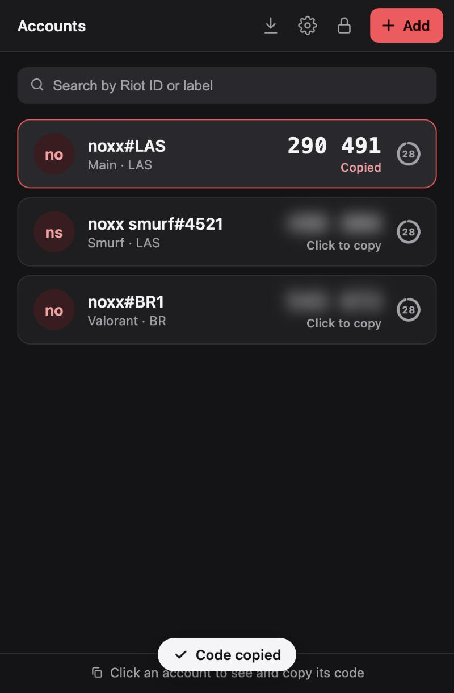

<div align="center">



# Riot2FA

**Two-factor authentication for your Riot Games accounts — right on your Mac. No phone needed.**


</div>

---

## What is it?

Riot2FA is a desktop app that manages the Riot Mobile verification codes for your
Riot Games accounts, so you can approve logins and queue ranked without a phone.

You sign in once per account; the app enables Riot Mobile verification, keeps the
secret **encrypted on your machine**, and generates valid 6-digit codes on demand.

> **macOS first. Windows is planned.**

## Features

- **One click to copy** — codes stay blurred until you click; one click reveals and
  copies the current code, then it hides itself again.
- **Sign in with Riot** — add an account by logging in; no secret keys to paste by
  hand. Each login runs in a private session, so you can add several accounts.
- **Encrypted on your Mac** — the account vault is encrypted with
  XChaCha20-Poly1305 and the master key lives in the macOS Keychain.
- **Touch ID** — unlock the app with Touch ID or your Mac password.
- **Every account together** — main, smurfs and each region in one list.
- **Themes** — Light, Dark, Red and Graphite, switchable anytime.
- **Multi-language** — follows your system language (English, Spanish, and more).
- **Import** — bring accounts in from a backup code, compatible with the
  `RIOT2FA1-` share format.

## Screenshots

<div align="center">

&nbsp;&nbsp;

&nbsp;&nbsp;

</div>

## How it works

| Area | Approach |
|---|---|
| Codes | TOTP with **SHA-256** (Riot's variant), 30-second period, 6 digits |
| Adding an account | In-app Riot login captures the session and enables Riot Mobile verification to retrieve the secret |
| Storage | Encrypted vault (XChaCha20-Poly1305); master key in the OS keychain |
| Unlock | Touch ID / Windows Hello via the system prompt |
| Import | Decodes `RIOT2FA1-` backup codes |

The core logic runs in Rust; nothing leaves your machine on its own.

## Tech stack

- **Rust** + **Tauri 2** — native shell using the system WebView (no bundled browser)
- **Svelte 5** + **TypeScript** + **Vite** — UI
- **chacha20poly1305**, **keyring**, **robius-authentication** — security

## Development

Requirements: [Rust](https://rustup.rs/), Node.js and [pnpm](https://pnpm.io/).

```bash
pnpm install
pnpm tauri dev
```

Build a release bundle:

```bash
pnpm tauri build
```

## Requirements for your account

- Email-based two-factor authentication must already be enabled on your Riot
  account (Riot requires it before Riot Mobile verification can be turned on).
- Only use this on accounts you own.

## Disclaimer

Riot2FA is an independent project and is **not affiliated with, endorsed by, or
sponsored by Riot Games**. "Riot Games" and related marks are trademarks of Riot
Games, Inc.
